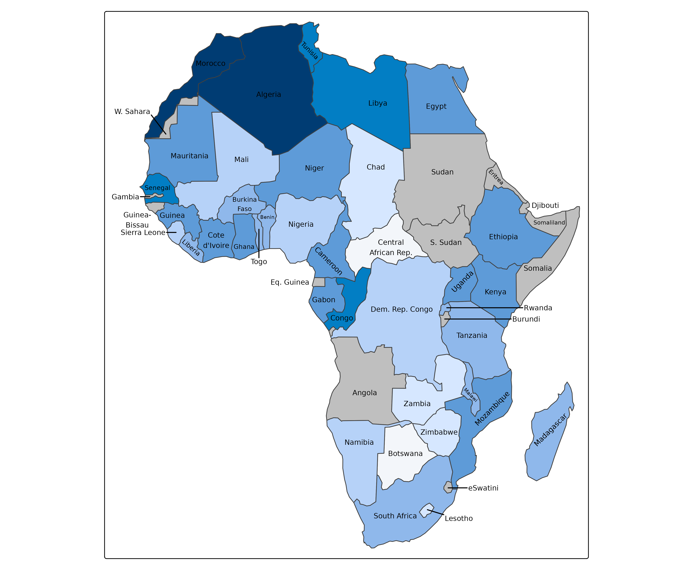
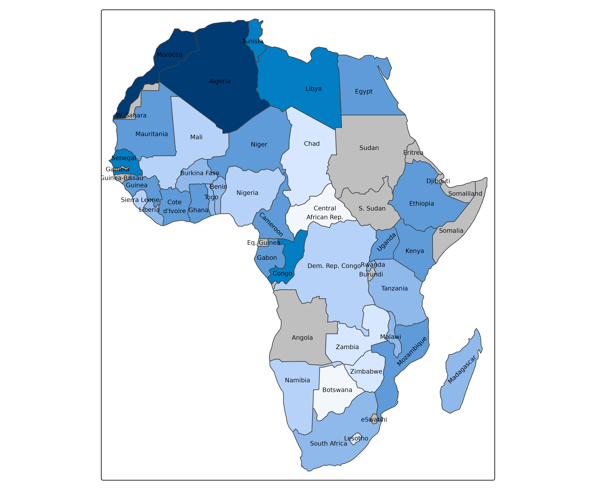
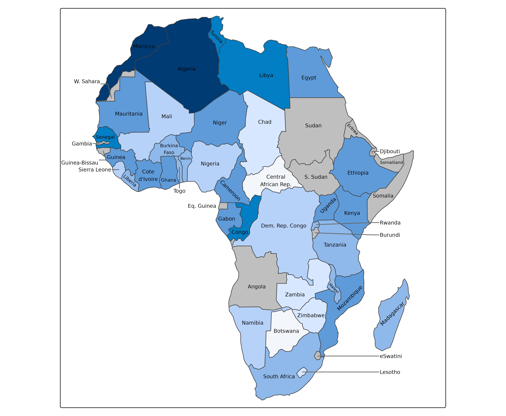
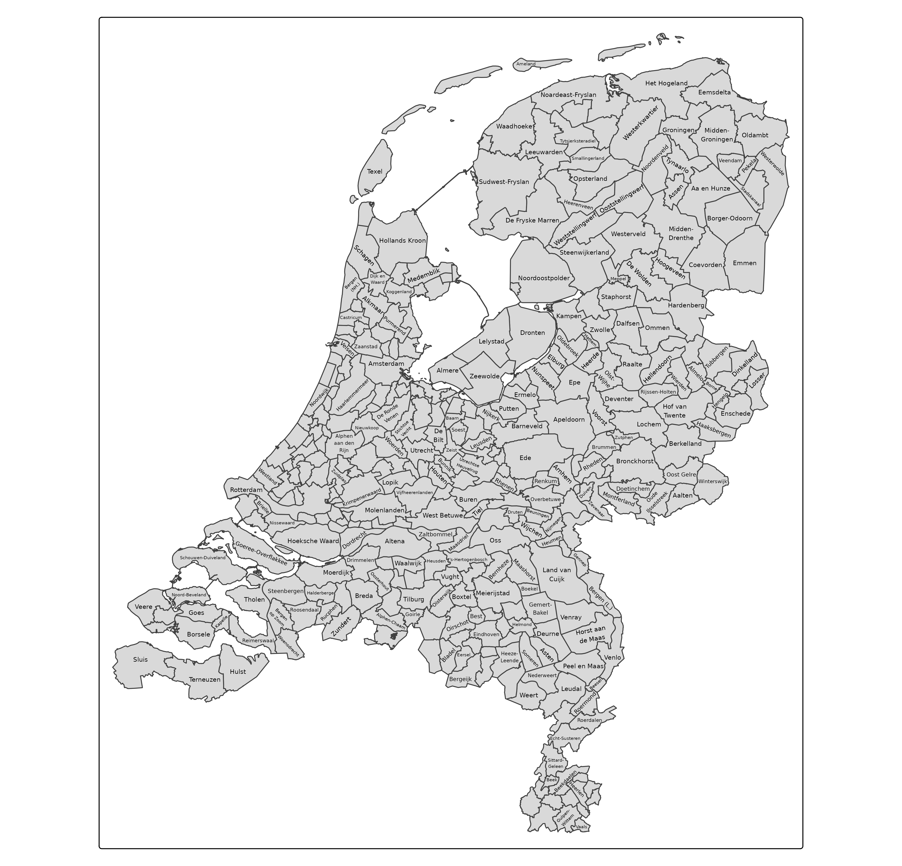
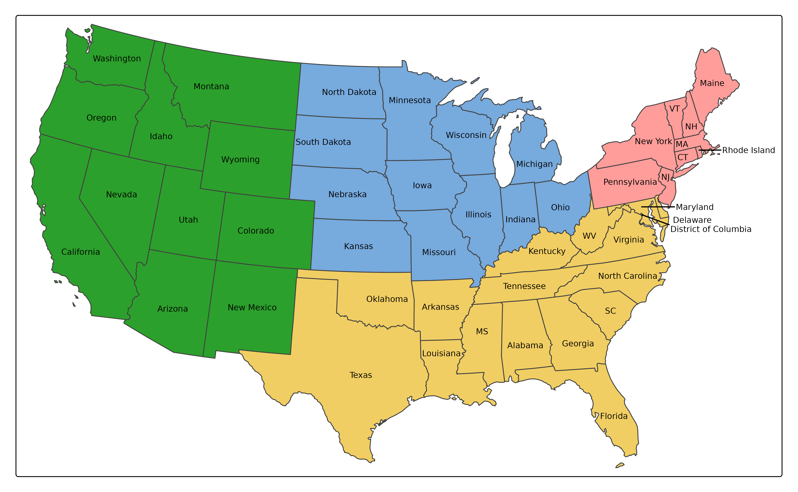
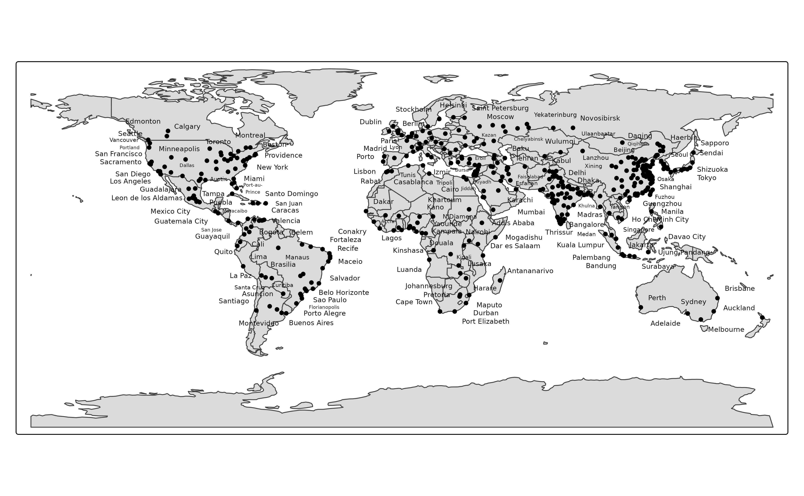

# tmap advanced: label placement

## Text versus labels

tmap has two layer functions for text:

- [`tm_text()`](https://r-tmap.github.io/tmap/reference/tm_text.md)
  draws text as data: the text is drawn exactly at the location of the
  feature, and its size, color, and font face can be map variables with
  a scale and a legend.
- [`tm_labels()`](https://r-tmap.github.io/tmap/reference/tm_text.md)
  names features. Labels are placed where they are readable: inside
  polygons, next to points, and outside the map features if needed.
  Labels that do not fit are dropped.

This article is about
[`tm_labels()`](https://r-tmap.github.io/tmap/reference/tm_text.md). Its
behavior is configured with
[`tm_placement()`](https://r-tmap.github.io/tmap/reference/tm_placement.md),
passed on to the `placement` argument of
[`opt_tm_labels()`](https://r-tmap.github.io/tmap/reference/tm_text.md).

## Polygon labels

A polygon label is placed at the center of the largest circle that fits
inside the polygon (also known as the pole of inaccessibility). For long
and thin polygons this spot is much better than the centroid, which may
even lie outside the polygon.

``` r

Africa = World[World$continent == "Africa", ]

tm_shape(Africa, crs = "+proj=robin") +
  tm_polygons("HPI", fill.legend = tm_legend_hide()) +
  tm_labels("name", size = 0.6) +
  tm_layout(inner.margins = c(0.02, 0.08, 0.02, 0.02))
```



When a label does not fit inside its polygon, the steps of a *fallback
chain* are tried, in this order:

1.  `"wrap"`: the text is broken into two or three lines (“Burkina
    Faso”, “Cote d’Ivoire”);
2.  `"rotate"`: the text is rotated along the main axis of the polygon,
    at most 45 degrees (Madagascar, Mozambique);
3.  `"shrink"`: the font size is decreased, down to 70% (Benin, Malawi);
4.  `"move"`: the label is moved outside, into free space, with a leader
    line (Gambia, Guinea-Bissau, Rwanda, Lesotho);
5.  `"drop"`: the label is dropped.

The steps are cumulative: a rotated label is also tried with wrapped
text, and a shrunk label also with wrapped and rotated text.

## Changing the fallback chain

The chain is the `fallback` argument of
[`tm_placement()`](https://r-tmap.github.io/tmap/reference/tm_placement.md).
Steps can be removed or reordered. The last step is either `"drop"` or
`"overlap"`, which keeps the labels that do not fit at their natural
spot. In the following map, labels are never shrunk or moved, and labels
that do not fit are kept:

``` r

tm_shape(Africa, crs = "+proj=robin") +
  tm_polygons("HPI", fill.legend = tm_legend_hide()) +
  tm_labels("name", size = 0.6,
    options = opt_tm_labels(placement = tm_placement(fallback = c("wrap", "rotate", "overlap"))))
```



There are also a few presets:

| preset | meaning |
|----|----|
| `"auto"` | the default, [`tm_placement()`](https://r-tmap.github.io/tmap/reference/tm_placement.md) |
| `"inside"` | labels never leave their polygon: wrap, rotate, shrink, or drop |
| `"callout"` | labels that do not fit are moved to a column next to the map |
| `"none"` | labels are placed at the centroids, as with [`tm_text()`](https://r-tmap.github.io/tmap/reference/tm_text.md) |

## Moving labels outside

The `"move"` step places a label in free space: not on top of other
polygons, labels, or the label spots of other features. The leader line
does not cross other leader lines or labels. With `move = "free"` (the
default), the nearest free spot is used, at most 15 label heights away
(or 25 if there is no free spot within 15 label heights). Labels that
cannot be moved are tried again with their text wrapped in two lines
(“Guinea-Bissau”). With `move = "column"` (as in the preset
`"callout"`), the labels are stacked in a column at the left or right
side of the map, whichever is nearest:

``` r

tm_shape(Africa, crs = "+proj=robin") +
  tm_polygons("HPI", fill.legend = tm_legend_hide()) +
  tm_labels("name", size = 0.6,
    options = opt_tm_labels(placement = "callout",
                            leader = tm_leader(col = "gray40", type = "elbow"))) +
  tm_layout(inner.margins = c(0.02, 0.1, 0.02, 0.1))
```



With `col = "auto"`, the text color of a moved label contrasts with the
map background instead of the polygon fill. The leader lines are
specified with
[`tm_leader()`](https://r-tmap.github.io/tmap/reference/tm_leader.md):
the color (by default the text color), line width, line type, the shape
(`"straight"` or `"elbow"`), and the minimum distance for which a leader
line is drawn. Use `leader = FALSE` to omit them.

Moved labels need free space within the map frame. When there is not
enough space, labels are dropped, and a message suggests to add space
with the `inner.margins` of
[`tm_layout()`](https://r-tmap.github.io/tmap/reference/tm_layout.md)
(bottom, left, top, right), as in the map above.

## Maps with many small polygons

Moving labels outside works well when only a few labels do not fit. On
maps with many small polygons, such as the municipalities of the
Netherlands, the many leader lines would clutter the map. Therefore, no
labels are moved when more than 25% of the labels do not fit; the labels
are then placed as with the preset `"inside"`. This threshold is the
argument `move.max` of
[`tm_placement()`](https://r-tmap.github.io/tmap/reference/tm_placement.md).
A message tells when this happens:

    [labels] 34% of the labels do not fit inside their polygons, which is too many to move outside (see `move.max` of `tm_placement()`)

``` r

tm_shape(NLD_muni) +
  tm_polygons() +
  tm_labels("name", size = 0.4)
```



## Short texts and priority

[`tm_labels()`](https://r-tmap.github.io/tmap/reference/tm_text.md) has
two data arguments for label placement:

- `short`: a data variable with short texts, e.g. abbreviations, used by
  the `"abbreviate"` step;
- `priority`: a data variable that determines the order in which labels
  are placed. Labels with a higher priority are placed first, so they
  get the best positions, and they are dropped last. By default, the
  priority is the area of the polygon, or the text size of a point
  label.

The US state map is a classic example: the names of the large states are
written in full, the small states in the northeast get their
abbreviation, and the ones for which even the abbreviation does not fit
are moved outside.

``` r

us = spData::us_states
us$abbr = state.abb[match(us$NAME, state.name)]
us$abbr[us$NAME == "District of Columbia"] = "DC"

tm_shape(us, crs = 5070) +
  tm_polygons("REGION", fill.legend = tm_legend_hide()) +
  tm_labels("NAME", short = "abbr", size = 0.6,
    options = opt_tm_labels(placement = tm_placement(
      fallback = c("abbreviate", "wrap", "move", "drop")))) +
  tm_layout(inner.margins = c(0.02, 0.02, 0.02, 0.06))
```



## Point labels

A point label is placed at one of the eight positions around the point,
in the order of preference of Imhof: top right, top left, bottom right,
bottom left, right, left, top, and bottom. A position is used when the
label does not overlap other labels or points. If none of the positions
is free, the fallback chain is used (without `"rotate"`). The distance
between a point and its label is the `gap` of
[`tm_placement()`](https://r-tmap.github.io/tmap/reference/tm_placement.md),
in line heights.

Here, the largest metropolitan areas are labeled first:

``` r

tm_shape(World) +
  tm_polygons() +
tm_shape(metro) +
  tm_dots() +
  tm_labels("name", priority = "pop2020", size = 0.5)
```



The placement of point labels of previous versions of tmap, an
optimization of the label positions with simulated annealing, is still
available with `tm_placement(method = "SANN")`.

## Interactive maps

In view mode (leaflet), polygon labels are placed at the center of the
largest inscribed circle, as in plot mode. After each zoom and pan,
labels that overlap with other labels are hidden, in the order of
`priority`. Zooming in creates space, so hidden labels will reappear. In
the modes `"maplibre"` and `"mapbox"` of the extension package
**tmap.mapgl**, the collision of labels is handled by MapLibre and
Mapbox, also in the order of `priority`, and point labels are placed at
the positions around the point.

The steps wrap, rotate, shrink, and move are only applied in plot mode,
since whether a label fits depends on the zoom level.

``` r

tmap_mode("view")
tm_shape(metro) +
  tm_dots() +
  tm_labels("name", priority = "pop2020")
```

## Overview

| argument | function | meaning |
|----|----|----|
| `fallback` | [`tm_placement()`](https://r-tmap.github.io/tmap/reference/tm_placement.md) | ordered steps for labels that do not fit: `"abbreviate"`, `"wrap"`, `"rotate"`, `"shrink"`, `"move"`, and finally `"drop"` or `"overlap"` |
| `rotate.max` | [`tm_placement()`](https://r-tmap.github.io/tmap/reference/tm_placement.md) | maximum rotation (degrees) |
| `shrink.min` | [`tm_placement()`](https://r-tmap.github.io/tmap/reference/tm_placement.md) | smallest font scale factor |
| `move` | [`tm_placement()`](https://r-tmap.github.io/tmap/reference/tm_placement.md) | `"free"`, `"column"`, or a side |
| `move.max` | [`tm_placement()`](https://r-tmap.github.io/tmap/reference/tm_placement.md) | maximum fraction of labels that are moved |
| `gap` | [`tm_placement()`](https://r-tmap.github.io/tmap/reference/tm_placement.md) | distance between points and their labels |
| `method` | [`tm_placement()`](https://r-tmap.github.io/tmap/reference/tm_placement.md) | `"greedy"`, `"SANN"`, or `"GA"` (point labels) |
| `col`, `lwd`, `lty`, `type`, `min.length` | [`tm_leader()`](https://r-tmap.github.io/tmap/reference/tm_leader.md) | leader lines |
| `short`, `priority` | [`tm_labels()`](https://r-tmap.github.io/tmap/reference/tm_text.md) | short texts and priority (data variables) |
