# tmap advanced: fill patterns

## Why patterns?

Polygons are usually filled with a color. A fill **pattern**, such as
hatching or dots, can be drawn on top of that color. Patterns are
useful:

- to show a second variable on top of a color, e.g. the uncertainty of
  an estimate;
- for maps that are printed in black and white;
- for accessibility, since patterns do not depend on color vision.

In tmap, the pattern is a map variable, just like `fill` and `col`. It
can be a constant value, or it can be mapped to a data variable with a
scale and a legend.

## A constant pattern

``` r

tm_shape(World) +
  tm_polygons("HPI", pattern = "hatch")
#> [tip] Consider a suitable map projection, e.g. by adding `+ tm_crs("auto")`.
#> This message is displayed once per session.
```

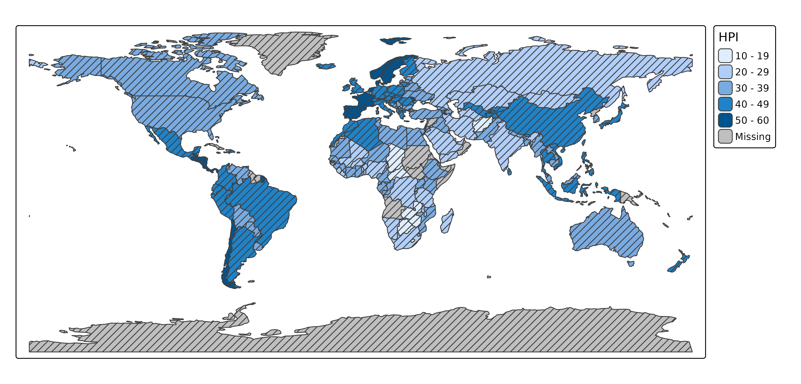

## Patterns by a data variable

When `pattern` is a data variable, each category gets its own pattern.
The patterns are drawn on top of the fill color, so color stays free for
another variable.

``` r

tm_shape(World) +
  tm_polygons("HPI", pattern = "economy")
```

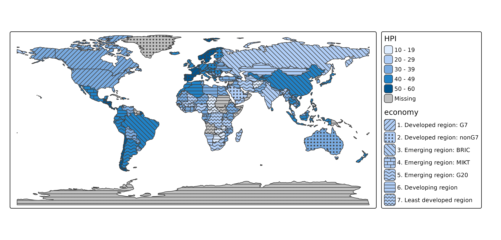

## Available patterns

The available pattern types and shortcuts are shown with
[`tmap_show_values()`](https://r-tmap.github.io/tmap/reference/tmap_show_values.md):

``` r

tmap_show_values("pattern")
```

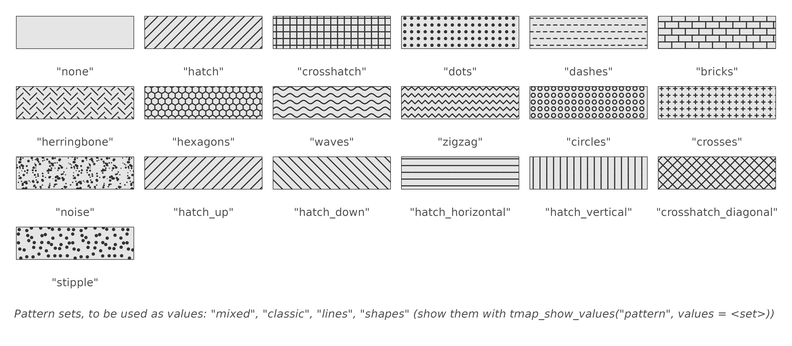

Patterns are specified as pattern types (e.g. `"hatch"`) or shortcuts
(e.g. `"hatch_down"`). For more control, use
[`tm_patterns()`](https://r-tmap.github.io/tmap/reference/tm_patterns.md),
which has parameters for the angle of the motif, the randomness of the
dots, and the length and amplitude of the motif elements:

``` r

tm_patterns("hatch", angle = c(30, 60))
#> [1] "hatch(angle=30)" "hatch(angle=60)"
tm_patterns("bricks", length = 3)
#> [1] "bricks(angle=0,length=3)"
```

## Pattern sets

Like color palettes, there are pattern sets, which are used as `values`
of a scale:

| Set | Patterns |
|----|----|
| `"mixed"` (default) | 14: hatch, dots, hatch_down, bricks, waves, hatch_horizontal, … |
| `"classic"` | 8: hatches in four directions, crosshatches, dots, dashes |
| `"lines"` | 10: hatches, waves, zigzag lines, dashes, herringbone, crosshatches |
| `"shapes"` | 6: dots, bricks, circles, hexagons, crosses, noise |

The first patterns of a set are used. The patterns in a set are ordered
such that neighboring patterns differ in motif, and not only in
orientation: an orientation of hatching alone is a weak way to
distinguish areas. The patterns of the sets, in this order, are shown
with
[`tmap_show_values()`](https://r-tmap.github.io/tmap/reference/tmap_show_values.md):

``` r

tmap_show_values("pattern", values = c("mixed", "classic", "lines", "shapes"))
```

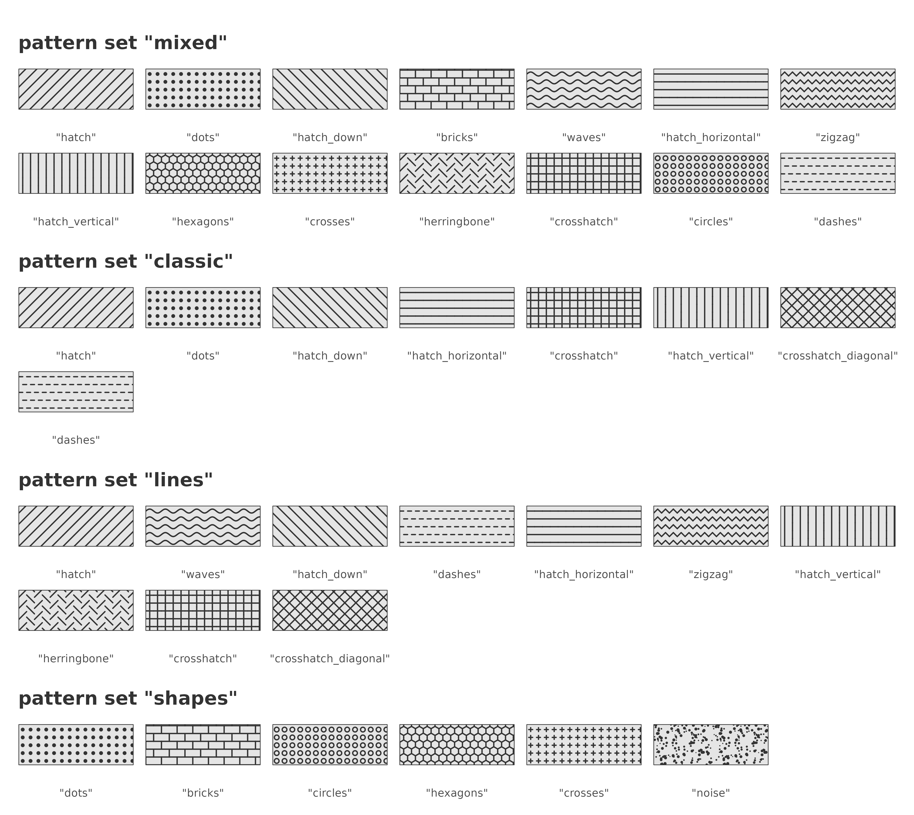

``` r

tm_shape(World) +
  tm_polygons("HPI", pattern = "economy",
              pattern.scale = tm_scale_categorical(values = "classic"))
```

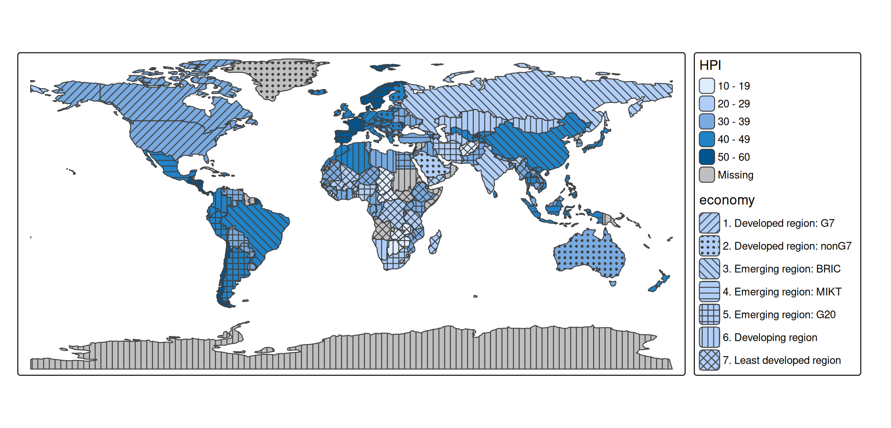

Patterns can also be specified per category, as a character vector, as a
list of
[`tm_patterns()`](https://r-tmap.github.io/tmap/reference/tm_patterns.md)
calls, or with one vectorized
[`tm_patterns()`](https://r-tmap.github.io/tmap/reference/tm_patterns.md)
call:

``` r

hatches = tm_patterns("hatch", angle = c(0, 30, 60, 90, 120))

tm_shape(World) +
  tm_polygons("HPI", pattern = "income_grp",
              pattern.scale = tm_scale_categorical(values = hatches))
```

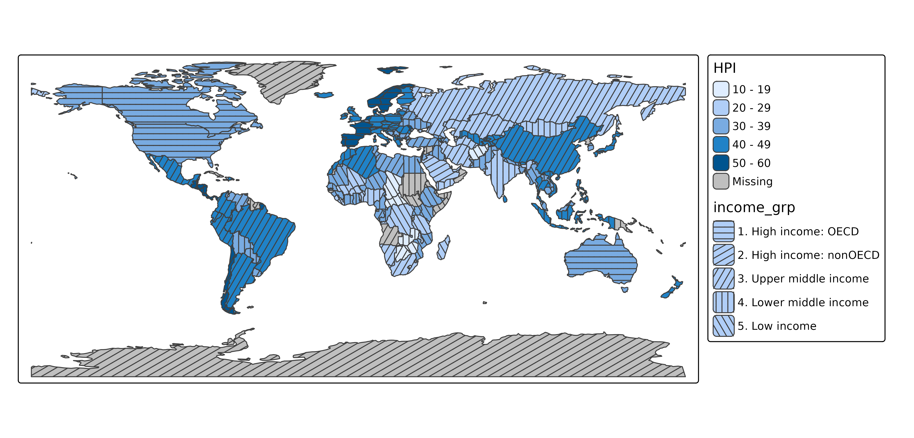

## Color, size, and density

Besides `pattern`, there are three map variables for patterns:

| Map variable | Description | Default |
|----|----|----|
| `pattern_col` | color of the pattern | the polygon border color |
| `pattern_size` | line width, or the size of dots | 1 |
| `pattern_density` | density of the pattern elements, from 0 (no pattern) to 1 | 0.8 |

At density 1, pattern elements are a quarter of a text line apart. All
three can be constant values or data variables. With
`pattern_col = "auto"`, the pattern color is dark gray or white,
whichever contrasts most with the fill color:

``` r

tm_shape(World) +
  tm_polygons("HPI", fill.scale = tm_scale_intervals(values = "brewer.blues"),
              pattern = "economy", pattern_col = "auto")
```

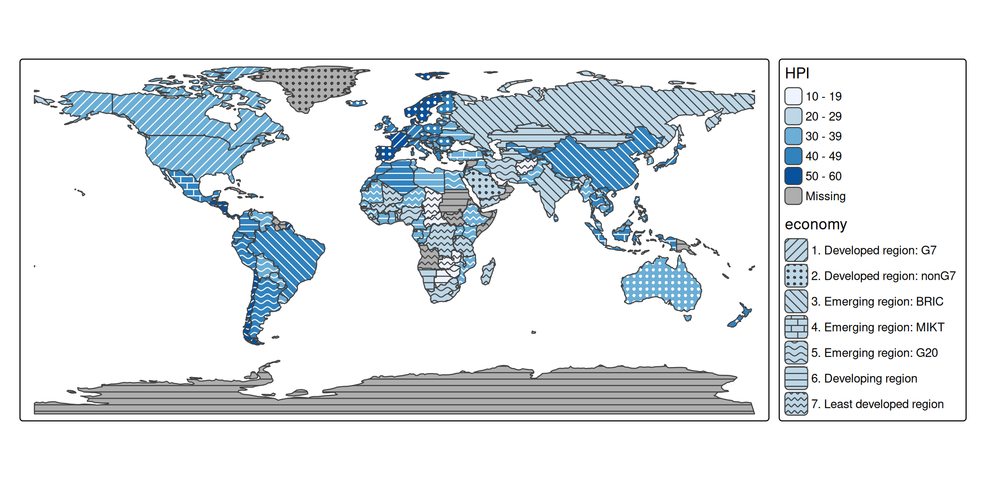

## Example: two categorical variables

Patterns are especially suited for categorical variables, since pattern
motifs have no natural order. With a color for one categorical variable
and a pattern for another, two categorical variables can be shown in one
map:

``` r

other = c("Antarctica", "Seven seas (open ocean)")
World2 = World[!(World$continent %in% other), ]
World2$continent = droplevels(World2$continent)

tm_shape(World2, crs = "+proj=eqearth") +
  tm_polygons(fill = "continent",
              fill.legend = tm_legend("Continent"),
              pattern = "income_grp",
              pattern.legend = tm_legend("Income group"))
```

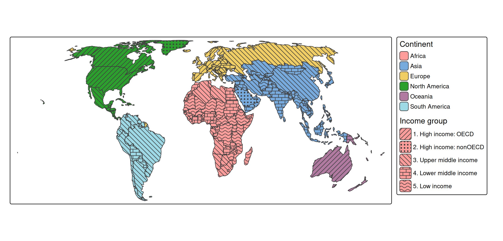

Note that the income groups are ordered, whereas the patterns are not:
the legend is needed to see which group is higher. For an ordered
variable, the density of a single pattern (`pattern_density`) conveys
the order better; see the dot density example below.

## Example: reliability of estimates

A typical use case is a map of estimates, where the estimates that are
less reliable are marked with a pattern. Statistical agencies often do
this for small areas, where an estimate is based on few observations. In
this example, the share of high incomes is shown for the districts of
two provinces of the Netherlands. Districts with fewer than 1000
inhabitants are hatched; for some of them, the estimate is not published
at all (missing values).

``` r

north = NLD_dist[NLD_dist$province %in% c("Groningen", "Drenthe"), ]
north$reliability = cut(north$population, breaks = c(-Inf, 1000, Inf),
                        right = FALSE,
                        labels = c("Low (< 1000 inhabitants)", "Sufficient"))

tm_shape(north) +
  tm_polygons(fill = "income_high",
              fill.scale = tm_scale_intervals(values = "-hcl.purples3",
                                              value.na = "grey85",
                                              label.na = "Not published"),
              fill.legend = tm_legend("High income (%)"),
              pattern = "reliability",
              pattern.scale = tm_scale_categorical(values = c("hatch", "none")),
              pattern.legend = tm_legend("Reliability"),
              pattern_col = "white",
              col = "grey60", lwd = 0.5)
```

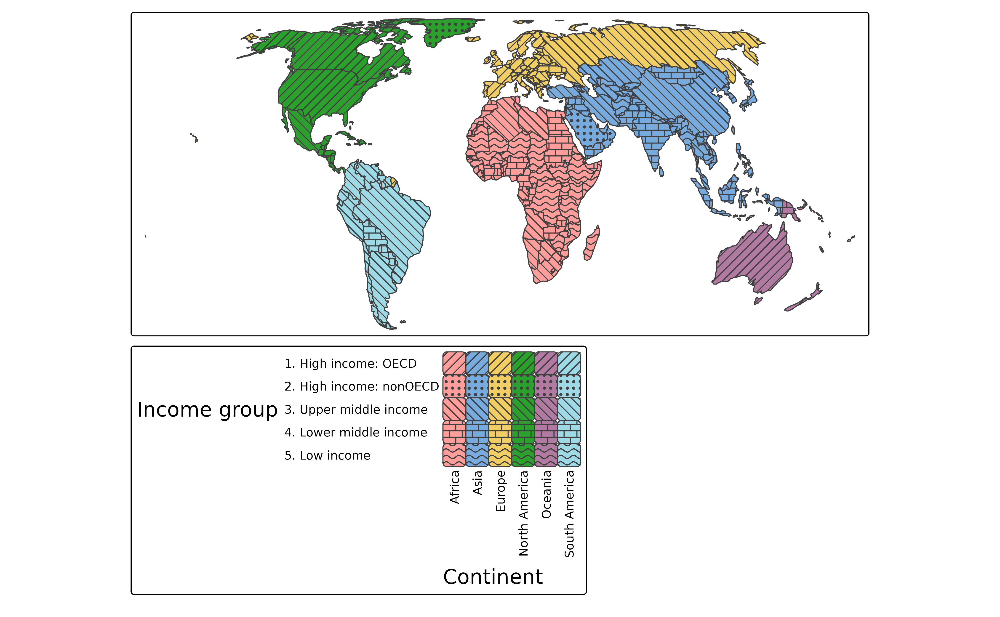

The eye averages a pattern with the fill color underneath. Dark lines
make an area look darker, and white lines make it look lighter, although
the fill color between the lines is unchanged. On a sequential palette,
hatched areas therefore seem to have a different value than they have.
This is why the reliability is shown with two classes, rather than with
a pattern density that increases with the uncertainty: all hatched areas
are hatched in the same way, so colors can be compared among the hatched
areas, and among the other areas. Only comparisons between the two
groups are biased, and the hatching makes clear which areas these are.
White hatches make the colors look faded, which fits the meaning “less
reliable”. A drawback is that white hatches are hardly visible on the
lightest colors; with `pattern_col = "auto"`, the hatches are dark gray
on light colors instead.

## Example: dot density

With the pattern `"stipple"` (dots that are randomly displaced from a
regular grid), `pattern_density` can be used to make a dot density map.
At density 1, there is one dot per square of a quarter text line wide.
Since the spacing between dots is inversely proportional to the density,
the number of dots per area is proportional to the *square* of the
density. So, to make the number of dots proportional to a data variable,
such as the population density, use a square root scale that starts at
0, with values from 0 to 1:

``` r

utrecht = NLD_dist[NLD_dist$province == "Utrecht", ]
utrecht$pop_dens = utrecht$population / as.numeric(utrecht$area)

tm_shape(utrecht) +
  tm_polygons(fill = "white", col = "grey80", lwd = 0.5,
              pattern = "stipple", pattern_size = 1.2, pattern_col = "grey10",
              pattern_density = "pop_dens",
              pattern_density.scale = tm_scale_continuous_sqrt(
                limits = c(0, 10000), values = c(0, 1),
                ticks = c(500, 2500, 5000, 10000)),
              pattern_density.legend = tm_legend("Inhabitants per km2"))
```

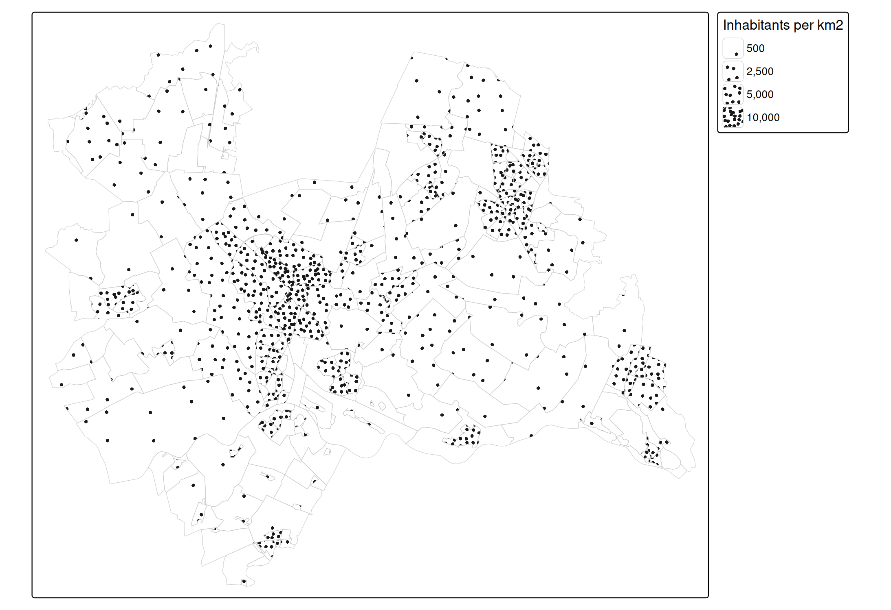

Each dot represents the same number of inhabitants: the upper limit
(here 10,000 inhabitants per km²) times the map area of one dot square
at density 1. The side of this square is a quarter of a text line, which
is 0.05 inch times the `scale` (see
[`tm_layout()`](https://r-tmap.github.io/tmap/reference/tm_layout.md));
in the map above, with scale 0.75, it is 0.0375 inch. So the number of
inhabitants per dot depends on the map scale, and therefore on the size
of the plot. Note that the dots are spread evenly within each district:
they do not show where people live within a district.

## Black and white maps

For a black and white map, use a white or light gray fill color:

``` r

tm_shape(World) +
  tm_polygons(fill = "white", pattern = "economy",
              pattern.scale = tm_scale_categorical(values = "classic"))
```

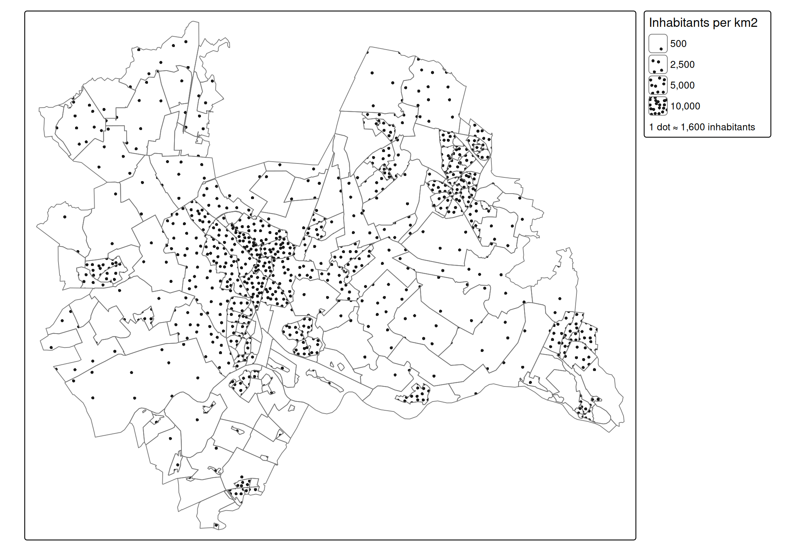

## Legends

Legend items of pattern legends are larger than the default legend
items, so that the pattern is visible. The pattern in the legend has the
same density and line width as on the map. The size of legend items can
be changed with `item.height` and `item.width` in
[`tm_legend()`](https://r-tmap.github.io/tmap/reference/tm_legend.md).
When the same data variable is used for `fill` and `pattern`, the
legends can be combined with
[`tm_legend_combine()`](https://r-tmap.github.io/tmap/reference/tm_legend.md):

``` r

tm_shape(World) +
  tm_polygons("economy", pattern = "economy",
              pattern.legend = tm_legend_combine("fill"))
```

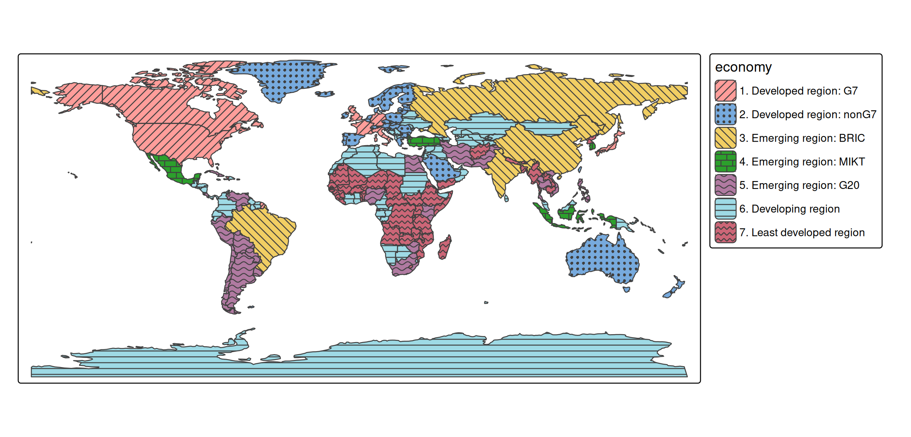

## View mode

In view mode, patterns keep the same size on the screen when zooming,
like the symbols of
[`tm_bubbles()`](https://r-tmap.github.io/tmap/reference/tm_symbols.md).
With `opt_tm_polygons(pattern.zoom = TRUE)`, patterns stick to the map
instead, and are enlarged when zooming in, like the circles of
[`tm_circles()`](https://r-tmap.github.io/tmap/reference/tm_circles.md).
The patterns in the legend are zoomed as well, so that they keep
matching the map (when zoomed in far, the legend items may be too small
to show the pattern):

``` r

tmap_mode("view")
tm_shape(World) +
  tm_polygons("HPI", pattern = "economy",
              options = opt_tm_polygons(pattern.zoom = TRUE))
```

## Notes

- In plot mode, patterns require a graphics device that supports
  clipping paths (R \>= 4.1), such as
  [`png()`](https://rdrr.io/r/grDevices/png.html),
  [`pdf()`](https://rdrr.io/r/grDevices/pdf.html), and
  [`svg()`](https://rdrr.io/r/grDevices/cairo.html).
- Higher densities take longer to draw, since there are more pattern
  elements.
- Patterns are currently available for polygons
  ([`tm_polygons()`](https://r-tmap.github.io/tmap/reference/tm_polygons.md)
  and
  [`tm_fill()`](https://r-tmap.github.io/tmap/reference/tm_polygons.md)).
- [`tmap_show_values()`](https://r-tmap.github.io/tmap/reference/tmap_show_values.md)
  also shows the available values of the other categorical map
  variables: symbol shapes (`"shape"`), line types (`"lty"`), and font
  faces (`"fontface"`).
