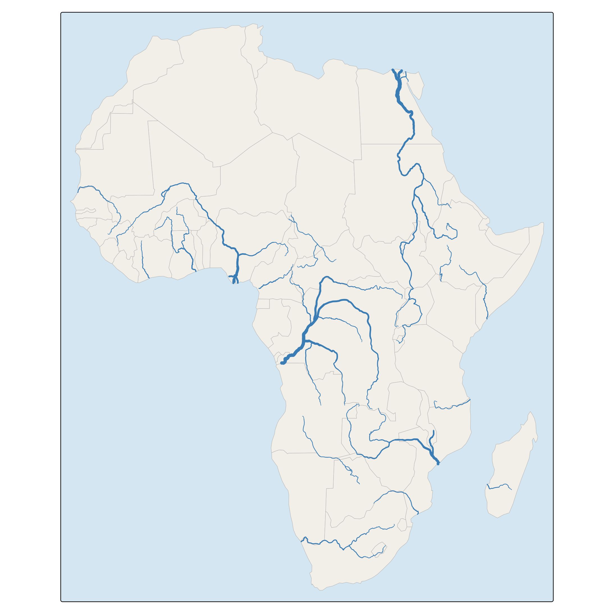
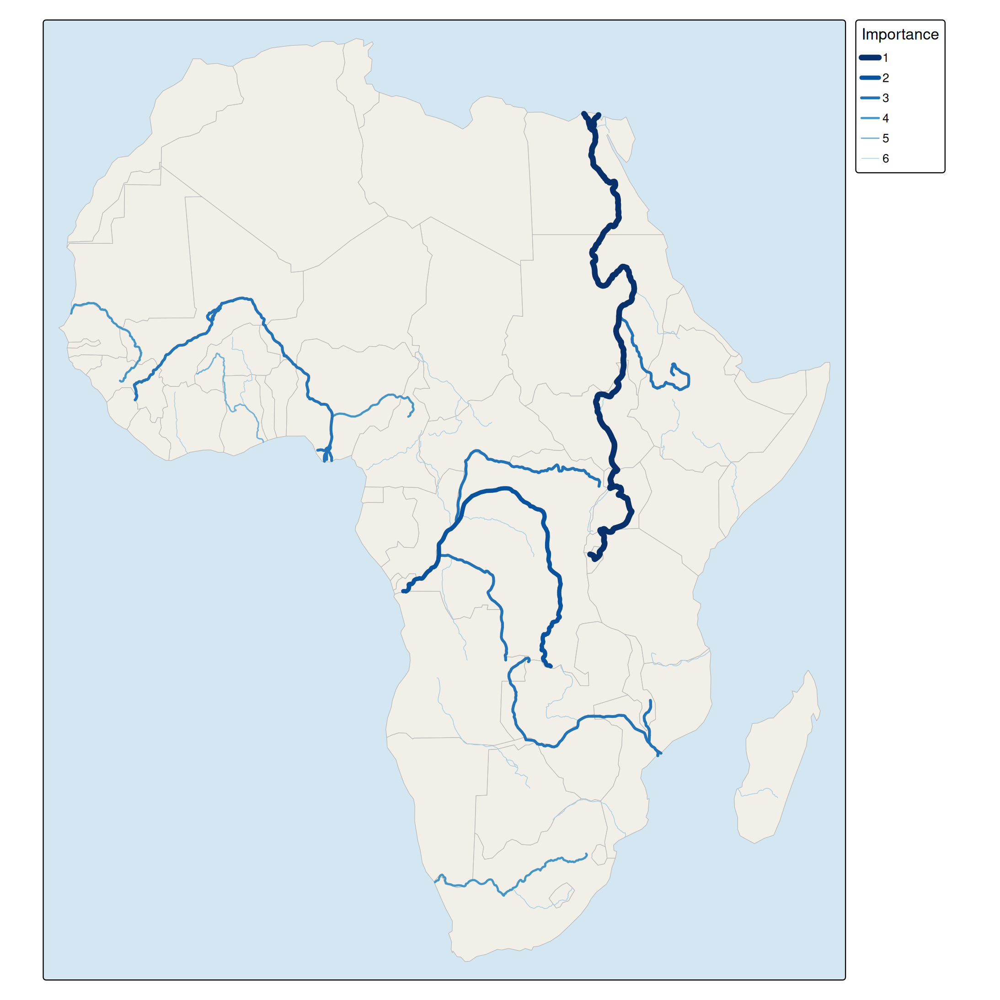
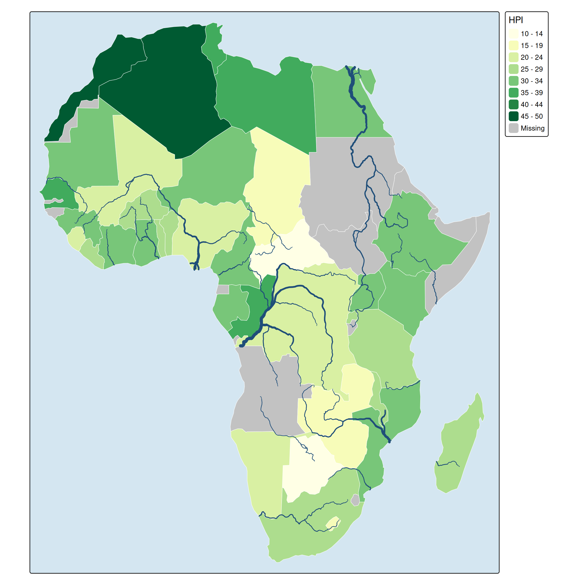

# tmap example: line map

``` r

library(tmap)
library(sf)
tmap_options(scale = 0.75)
```

Line maps show linear features, such as rivers, roads, and routes. The
main map variables are the line width (`lwd`) and the line color
(`col`). In this example, we map the rivers of Africa.

## About the data

`World_rivers` contains the main rivers and lakes of the world. The
variable `strokelwd` is a line width that increases downstream, and
`scalerank` indicates the importance (1 is the most important):

``` r

head(World_rivers)
#> Simple feature collection with 6 features and 4 fields
#> Geometry type: MULTILINESTRING
#> Dimension:     XY
#> Bounding box:  xmin: -94.637 ymin: 40.722 xmax: 0.891 ymax: 47.456
#> Geodetic CRS:  WGS 84
#>          name            type scalerank strokelwd
#> 1        <NA>           River         5       2.0
#> 2        Ebro           River         5       1.5
#> 3        Ebro           River         5       2.0
#> 4        Ebro           River         5       2.5
#> 5        Ebro           River         5       3.0
#> 6 Mississippi Lake Centerline         5       2.0
#>                         geometry
#> 1 MULTILINESTRING ((-72.991 4...
#> 2 MULTILINESTRING ((-4.189 43...
#> 3 MULTILINESTRING ((-1.748 42...
#> 4 MULTILINESTRING ((-1.748 42...
#> 5 MULTILINESTRING ((0.395 41....
#> 6 MULTILINESTRING ((-94.507 4...
```

We select the rivers in Africa:

``` r

Africa = World[World$continent == "Africa", ]
sf_use_s2(FALSE)
rivers = st_intersection(World_rivers, st_union(Africa))
sf_use_s2(TRUE)
```

## Line widths as they are

The variable `strokelwd` already contains line widths, so it is used as
it is, with
[`tm_scale_asis()`](https://r-tmap.github.io/tmap/reference/tm_scale_asis.md).
The argument `values.scale` makes all lines thinner or thicker:

``` r

tm_shape(Africa, crs = "+proj=robin") +
  tm_polygons(fill = "#F2EFE9", col = "grey70", lwd = 0.5) +
tm_shape(rivers) +
  tm_lines(lwd = "strokelwd", lwd.scale = tm_scale_asis(values.scale = 0.5),
    col = "#3A7DB5") +
tm_layout(bg.color = "#D4E6F1")
```



## Line widths and colors as map variables

Data variables can also be mapped to line widths and colors with a scale
and a legend. Here, the importance of a river is mapped to both the line
width and the color. Since `scalerank` is a rank (1 is the most
important), the scale is reversed with a decreasing sequence of line
widths, and the two legends are combined:

``` r

tm_shape(Africa, crs = "+proj=robin") +
  tm_polygons(fill = "#F2EFE9", col = "grey70", lwd = 0.5) +
tm_shape(rivers) +
  tm_lines(
    lwd = "scalerank",
    lwd.scale = tm_scale_categorical(values = c(4, 3, 2, 1.5, 1, 0.5)),
    lwd.legend = tm_legend("Importance"),
    col = "scalerank",
    col.scale = tm_scale_categorical(values = "-brewer.blues", values.range = c(0.35, 1)),
    col.legend = tm_legend_combine("lwd")) +
tm_layout(bg.color = "#D4E6F1")
```



## Lines on top of a choropleth

Lines can be combined with other layers. In this map, the rivers are
drawn on top of a choropleth of the Happy Planet Index:

``` r

tm_shape(Africa, crs = "+proj=robin") +
  tm_polygons(fill = "HPI", fill.scale = tm_scale_intervals(values = "brewer.yl_gn"),
    col = "white", lwd = 0.5) +
tm_shape(rivers) +
  tm_lines(lwd = "strokelwd", lwd.scale = tm_scale_asis(values.scale = 0.5),
    col = "#1F4E79") +
tm_layout(bg.color = "#D4E6F1")
```



For a network, such as roads or rail, see the extension package
[**tmap.networks**](https://r-tmap.github.io/tmap/articles/ext_networks).
For lines with a data-driven width that represent flows,
[`tm_lines()`](https://r-tmap.github.io/tmap/reference/tm_lines.md) can
be used in the same way, with the flow volume mapped to `lwd`.
