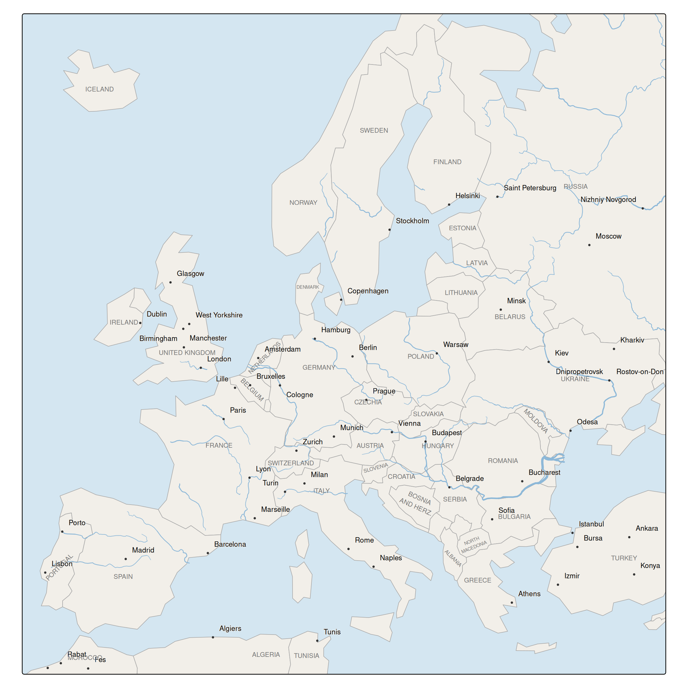
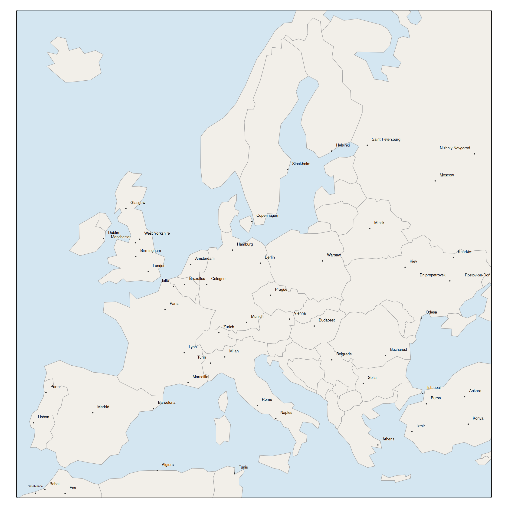

# tmap example: reference map

``` r

library(tmap)
tmap_options(scale = 0.75)
```

A *reference map* shows where things are: countries, cities, and rivers,
each with its name. Unlike a thematic map, the labels are the main
content. In this example, we make a reference map of Europe with
[`tm_labels()`](https://r-tmap.github.io/tmap/reference/tm_text.md),
which places the labels where they are readable (see the article on
[label placement](https://r-tmap.github.io/tmap/articles/adv_labels)).

## About the data

We use three data sets of tmap: `World` (countries), `metro`
(metropolitan areas, with population estimates from 1950 to 2030), and
`World_rivers`. Country names are written in capitals, as is common in
reference maps:

``` r

World$NAME = toupper(World$name)
```

The map extent is specified with a bounding box in the Lambert azimuthal
equal-area projection for Europe (EPSG 3035):

``` r

bb_europe = sf::st_bbox(c(xmin = 2600000, ymin = 1400000, xmax = 6400000, ymax = 5300000), crs = 3035)
```

## The map

``` r

tm_shape(World, crs = 3035, bbox = bb_europe) +
  tm_polygons(fill = "#F2EFE9", col = "grey65", lwd = 0.7) +
tm_shape(World_rivers) +
  tm_lines(col = "#8DB8D8", lwd = "strokelwd", lwd.scale = tm_scale_asis(values.scale = 0.4)) +
tm_shape(World) +
  tm_labels("NAME", size = 0.55, col = "grey45",
    options = opt_tm_labels(placement = "inside")) +
tm_shape(metro) +
  tm_dots(size = 0.15, fill = "grey20") +
  tm_labels("name", priority = "pop2020", size = 0.6,
    options = opt_tm_labels(halo = TRUE, halo.col = "#F2EFE9")) +
tm_layout(bg.color = "#D4E6F1")
```



## How the labels are placed

**Country names** are placed at the center of the largest circle that
fits inside the country. With the preset `placement = "inside"`, labels
never leave their country: names that do not fit are wrapped
(`"BOSNIA AND HERZ."`), rotated along the main axis of the country
(`"PORTUGAL"`, `"NETHERLANDS"`), shrunk (`"DENMARK"`), or dropped
(Luxembourg). Countries that cross the map frame, such as Russia and
Algeria, are labeled at the center of their visible part. Moving labels
outside, the default, does not work well for a reference map, since a
country name next to the country would be confused with the neighbors.

**City names** are placed at one of the eight positions around the city,
in the order of preference of Imhof: top right first. The largest cities
are placed first (`priority = "pop2020"`), so they get the best
positions, and cities for which there is no free position are dropped.
The halo, in the land color, keeps the names readable on top of rivers
and borders.

The **order of the layers** matters: the cities are drawn on top of the
country names.

## Variations

The level of detail is determined by the size of the labels and the
number of features. With a smaller font size, more city names fit:

``` r

tm_shape(World, crs = 3035, bbox = bb_europe) +
  tm_polygons(fill = "#F2EFE9", col = "grey65", lwd = 0.7) +
tm_shape(metro) +
  tm_dots(size = 0.1, fill = "grey20") +
  tm_labels("name", priority = "pop2020", size = 0.45,
    options = opt_tm_labels(halo = TRUE, halo.col = "#F2EFE9")) +
tm_layout(bg.color = "#D4E6F1")
```


