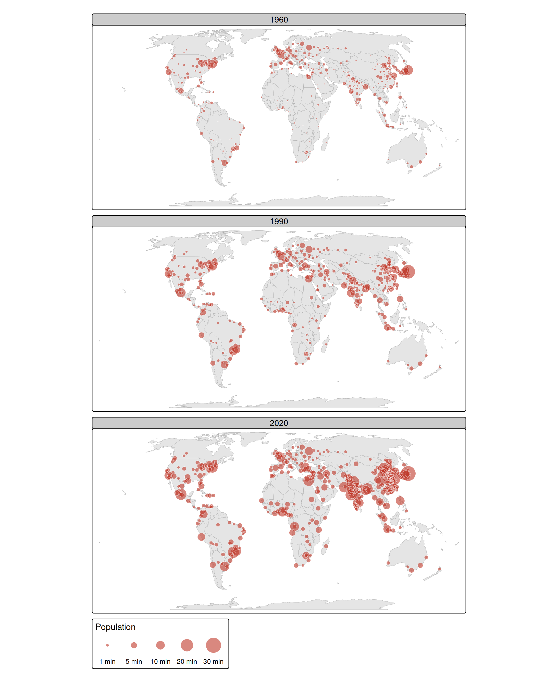
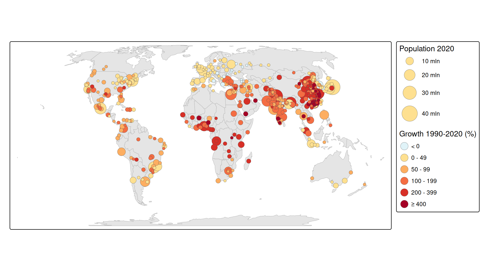

# tmap example: change over time

``` r

library(tmap)
tmap_options(scale = 0.75)
```

How do we show change on a map? This example shows three ways: small
multiples (one map per year), a map of the change itself, and an
animation. The data are the populations of the largest metropolitan
areas in the world, from 1950 to 2030.

## About the data

`metro` contains 436 metropolitan areas, with one population variable
per decade:

``` r

names(metro)
#>  [1] "name"      "name_long" "iso_a3"    "pop1950"   "pop1960"   "pop1970"  
#>  [7] "pop1980"   "pop1990"   "pop2000"   "pop2010"   "pop2020"   "pop2030"  
#> [13] "geometry"
```

## Small multiples

When a map variable gets several data variables, a facet is made for
each of them. Here, the bubble sizes of three years are shown below each
other with
[`tm_facets_vstack()`](https://r-tmap.github.io/tmap/reference/tm_facets.md):

``` r

tm_shape(World, crs = "+proj=eqearth") +
  tm_polygons(fill = "grey90", col = "grey70", lwd = 0.5) +
tm_shape(metro) +
  tm_bubbles(
    size = c("pop1960", "pop1990", "pop2020"),
    size.scale = tm_scale_continuous_area(values.scale = 2, ticks = c(1, 5, 10, 20, 30) * 1e6),
    size.free = FALSE,
    size.legend = tm_legend("Population", orientation = "landscape",
      position = tm_pos_out("center", "bottom")),
    fill = "#C0392B", fill_alpha = 0.6, col = "white", lwd = 0.3) +
  tm_facets_vstack() +
  tm_layout(panel.labels = c("1960", "1990", "2020"))
```



Two settings are essential to compare the maps:

- `size.free = FALSE`: the facets share one size scale (and one legend),
  so a bubble of 10 million has the same size in each year;
- [`tm_scale_continuous_area()`](https://r-tmap.github.io/tmap/reference/tm_scale_continuous_area.md):
  the area of a bubble is proportional to the population, which is how
  we perceive the size of a bubble (see the [article on
  scales](https://r-tmap.github.io/tmap/articles/basics_scales)).

## Mapping the change

Small multiples show the state at each moment, but the change itself has
to be read by comparing the maps. When the change is the message, it is
better to map it directly. Here, we compute the growth between 1990 and
2020 in percent:

``` r

metro$growth = (metro$pop2020 / metro$pop1990 - 1) * 100
```

The growth is mapped to the fill color, with a diverging palette around
zero, and the population of 2020 to the size:

``` r

tm_shape(World, crs = "+proj=eqearth") +
  tm_polygons(fill = "grey90", col = "grey70", lwd = 0.5) +
tm_shape(metro) +
  tm_bubbles(
    size = "pop2020",
    size.scale = tm_scale_continuous_area(values.scale = 2),
    size.legend = tm_legend("Population 2020"),
    fill = "growth",
    fill.scale = tm_scale_intervals(breaks = c(-Inf, 0, 50, 100, 200, 400, Inf),
      values = "-brewer.rd_yl_bu", midpoint = 0),
    fill.legend = tm_legend("Growth 1990-2020 (%)"),
    col = "grey30", lwd = 0.3)
```



The fastest growing metropolitan areas are in Africa and Asia, while
most metropolitan areas in Europe and North America have grown less than
50%.

## Animation

An animation shows the change as a movie: one frame per year. Replace
the facets by
[`tm_animate()`](https://r-tmap.github.io/tmap/reference/tm_animate.md),
and use all decades:

``` r

tm_shape(World, crs = "+proj=eqearth") +
  tm_polygons(fill = "grey90", col = "grey70", lwd = 0.5) +
tm_shape(metro) +
  tm_bubbles(
    size = paste0("pop", seq(1950, 2030, by = 10)),
    size.scale = tm_scale_continuous_area(values.scale = 2),
    size.free = FALSE,
    fill = "#C0392B", fill_alpha = 0.6, col = "white", lwd = 0.3) +
  tm_animate(fps = 2)
```

See the article on
[animations](https://r-tmap.github.io/tmap/articles/adv_animations) for
the result and for more options, such as smooth transitions between the
frames.

Which one to choose? Small multiples are best for printed media and for
comparing specific moments, a map of the change is best when the change
is the message, and an animation is best for presentations, to show the
overall trend.
