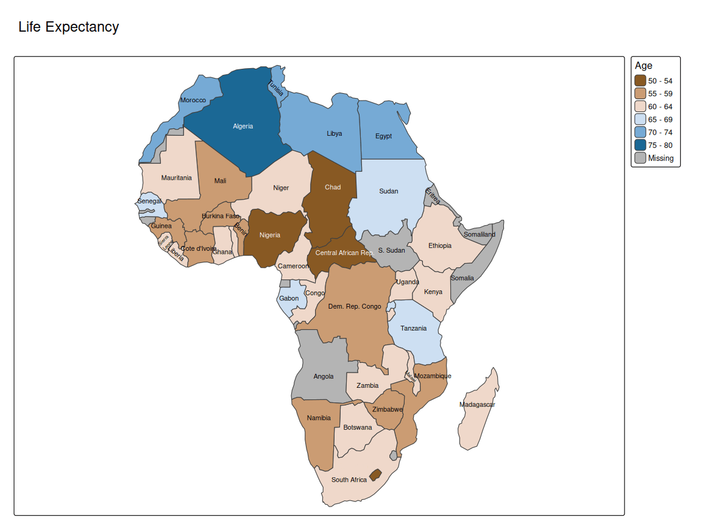
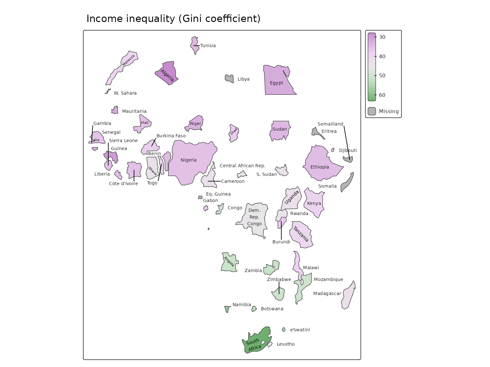
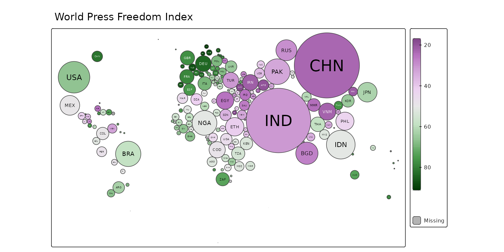

# tmap extensions: tmap.cartogram

## Cartograms

In cartograms, areal regions are distorted such that the obtained area
sizes are proportional to a quantitative variable. There are three
types: contiguous, non-contiguous and dorling cartogram.

The extension package
[**tmap.cartogram**](https://r-tmap.github.io/tmap.cartogram/) provides
new layer functions for tmap to create various types of cartograms.

It is strongly recommended to use an equal area crs (see
[instructions](https://r-tmap.github.io/tmap.cartogram/articles/intro#map-projection)).

## Contiguous cartogram

The shapes of the polygons are distorted, where the neighborhood
relationships between them are preserved as much as possible.

Labels follow the distorted shapes. With
[`tm_labels()`](https://r-tmap.github.io/tmap/reference/tm_text.md),
each label is placed at the center of the largest circle that fits
inside its polygon, and it is wrapped, rotated, or shrunk if needed (see
the article on [label
placement](https://r-tmap.github.io/tmap/articles/adv_labels)). The
preset `"inside"` keeps the labels inside their polygons. With
`col = "auto"`, each label is black or white, depending on the fill
color underneath.

``` r

Africa = World[World$continent == "Africa", ]

tm_shape(Africa, crs = "+proj=robin") +
  tm_cartogram(
    size = "*pop_est", 
    fill = "life_exp",
    fill.scale = tm_scale_intervals(values = "-cols4all.bu_br_div"),
    fill.legend = tm_legend("Age"),
    options = opt_tm_cartogram(itermax = 15)) +
  tm_labels("name", col = "auto", size = 0.6,
    options = opt_tm_labels(placement = "inside")) +
tm_title("Life Expectancy") +
tm_animate_fast(play = "pingpong")
#> Cartogram in progress...
```



## Non-contiguous cartograms

Here, the polygons are only resized while they keep their shape. Most
labels do not fit inside the shrunk polygons, but there is plenty of
free space around them. Therefore, labels are moved outside, even when
many of them do not fit (`move.max = 1`):

``` r

tm_shape(Africa, crs = "+proj=robin") +
  tm_cartogram_ncont(
    size = "pop_est", 
    fill = "inequality",
    fill.scale = tm_scale_continuous(values = "cols4all.pu_gn_div", values.range = c(0, 0.5)),
    fill.legend = tm_legend(""),
    options = opt_tm_cartogram_ncont()) +
  tm_labels("name", col = "auto", size = 0.6,
    options = opt_tm_labels(placement = tm_placement(move.max = 1))) +
tm_title("Income inequality (Gini coefficient)")
#> Cartogram in progress...
#> [labels] 1 label could not be moved outside: not enough free space near its
#> feature
#> ℹ Add space around the map with e.g. `tm_layout(inner.margins = c(0.02, 0.1,
#>   0.02, 0.1))` (bottom, left, top, right)
#> This message is displayed once every 8 hours.
```



## Dorling cartogram

Polygons are replaced by non-overlapping bubbles. The labels are scaled
with the bubbles: with
[`tm_scale_continuous_area()`](https://r-tmap.github.io/tmap/reference/tm_scale_continuous_area.md),
the font size is proportional to the square root of `pop_est`, just like
the bubble diameters. Labels that do not fit inside their bubble are
shrunk, or dropped.

``` r

tm_shape(World, crs = "+proj=robin") +
  tm_cartogram_dorling(
    size = "pop_est", 
    fill = "press",
    fill.scale = tm_scale_continuous(values = "cols4all.pu_gn_div", midpoint = 50),
    fill.legend = tm_legend("", height = 30)) +
  tm_labels("iso_a3", col = "auto", size = "pop_est",
    size.scale = tm_scale_continuous_area(values.scale = 2),
    size.legend = tm_legend_hide(),
    options = opt_tm_labels(placement = "inside")) +
tm_title("World Press Freedom Index")
#> Cartogram in progress...
```


